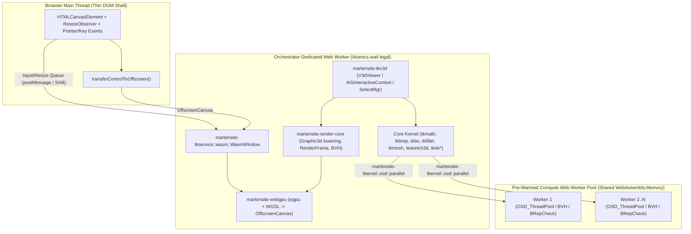

# WebAssembly and WebGPU implementation plan

Martensite tracks this work in [Milestone M10](https://github.com/Oblikovati/Martensite/milestone/25) across feature issues [#630](https://github.com/Oblikovati/Martensite/issues/630) through [#636](https://github.com/Oblikovati/Martensite/issues/636). This document records the approved scope, the codebase readiness audit, the browser execution model, the phased roadmap, and the verification gates for bringing multi-threaded WebAssembly (`wasm32-unknown-unknown` with `+atomics`) and WebGPU (`wgpu`) visualization to Martensite.

## Scope and decisions

The maintainer approved the following boundaries on 2026-11-27:

| Topic | Decision |
| --- | --- |
| Target and consumer surface | Browser `wasm32-unknown-unknown` for Rust crate consumers, plus thin `wasm-bindgen` and `web-sys` canvas, input, and surface glue. Full JS/TS SDK packaging is deferred. |
| Browser feature floor | Use only WebAssembly, Web Worker, Canvas, COOP/COEP (`require-corp`), and WebGPU features supported across the latest versions of Chromium, Firefox, and macOS Safari. Do not require single-browser extensions for correctness. |
| Performance baseline | Use the latest Chromium release as the performance baseline for all WebAssembly and WebGPU benchmarks, frame-time targets, and multi-worker scaling measurements. |
| Threading model | Require multi-threaded `wasm32` (`+atomics`, `+bulk-memory`, `+mutable-globals`, Web Workers, and `SharedArrayBuffer`) from the start. |
| Renderer layering | Extract the backend-agnostic Graphic3d lowering and scene representation out of `martensite-vulkan` into `martensite-render-core`, then build `martensite-webgpu` (`wgpu`) alongside `martensite-vulkan`. |
| Rendering parity | Deliver parity in two phases. Phase 1 covers the interactive CAD viewport (PBR, Phong, unlit, mesh edges, wide and stippled lines, points, clipping and stencil capping, pure-Rust text, backgrounds, 4x MSAA, WBOIT, shadow maps, instanced placement culling, and `tkv3d` picking). Phase 2 adds compute ray and path tracing, stereo composition, subview blits, and WGSL user shader programs. |

## Browser execution topology

Four architectural constraints govern how Martensite runs in a browser:

1. The browser main thread never blocks. Calling `Atomics.wait` on the main window thread throws `TypeError`, so blocking `Mutex` contention, `StandardCondition::wait`, `OSD_ThreadPool` joins, and parallel kernel scopes run inside the Orchestrator Worker and the pre-warmed Compute Worker Pool. Binding `OffscreenCanvas` to WebGPU inside the Orchestrator Worker avoids cross-thread frame serialization. `WasmWindow` also supports a main-thread `HtmlCanvasElement` binding for hosts or browsers that keep presentation on the main thread while running kernel compute in a worker.
2. Compute workers are pre-warmed before synchronous kernel calls. Spawning a new `web_sys::Worker` and immediately waiting on `Atomics.wait` deadlocks browser event loops. `martensite-tkernel` exposes an async bootstrap (`init_wasm_worker_pool(count).await`) that starts and handshakes the worker pool before any synchronous `OSD_Parallel`, `BVH`, or `BRepCheck` operation runs.
3. WebGPU initialization and host readback stay async behind the synchronous driver trait. [Graphic3dGraphicDriver](../../../crates/martensite-tkservice/src/graphic3d/graphic_driver.rs#L222-L310) is synchronous. `WebGpuRenderDriver::new_async(...).await` performs `wgpu::Instance::request_adapter` and `Adapter::request_device` before returning `Handle<dyn Graphic3dGraphicDriver>`. Once constructed, `create_structure`, `create_view`, command encoding, `queue.submit`, and `surface.present` are synchronous. Frame readback (`wgpu::BufferSlice::map_async`) is async on WebGPU: `WebGpuRenderViewExt::capture_async(...)` returns `FrameCapture` on `wasm32`, while synchronous `to_pixmap()` succeeds on native `wgpu` (`device.poll(Wait)`) and returns a typed `RenderError::AsyncReadbackRequired` on `wasm32`.
4. Realm-confined JS and WebGPU objects satisfy `Transient: Send + Sync` without custom `unsafe` or `thread_local!`. [Transient](../../../crates/martensite-tkernel/src/standard/transient.rs#L6) requires `Any + Send + Sync`, while `web_sys` canvas handles and `wgpu` WebGPU handles are `!Send + !Sync` under `wasm32` with `+atomics`. Because the workspace forbids `unsafe_code` ([Cargo.toml](../../../Cargo.toml#L38)) and [global_state_guard.rs](../../../scripts/build/src/global_state_guard.rs#L32-L63) rejects new `thread_local!` and `static mut` items, `WasmWindow` and `martensite-webgpu` wrap realm-confined handles in an audited checked thread-affinity container (such as `send_wrapper::SendWrapper` or `fragile::Fragile`, evaluated in Phase 0). Access on the owning realm thread incurs a thread-ID check and no IPC; wrong-thread access returns a typed `RenderError::ThreadConfined` error, and explicit `close()` releases handles on the owning thread. Both `martensite-render-core` and `martensite-webgpu` keep `unsafe_code = "forbid"`.

## Codebase readiness audit

An inspection of all 48 workspace crates at `bcd19a6a6` shows where platform dependencies sit:

| Layer | Crates | Blockers for multi-threaded `wasm32` and WebGPU |
| --- | --- | --- |
| Transcendental math | `martensite-cmath` | Uses pure-Rust `metallic = "=0.3.0"`. Only one `extern "C"` declaration remains in release builds: `ffi::remainder` in [lib.rs](../../../crates/martensite-cmath/src/lib.rs#L97-L119). |
| Foundation toolkit | `martensite-tkernel` | 27 files gate code on `cfg(unix)` or `cfg(windows)` without a `wasm32` or `not(any(unix, windows))` fallback: wall and CPU clocks, signals, thread IDs, online CPU count, `OSD_ThreadPool` worker spawning, `mmgr_opt` OS pages, `mem_info`, `c_format`, `osd::document_file`, `osd::file`, `osd::error`, `creation_date`, and `printer_system_log`. |
| Core CAD and exchange | `tkmath`, `tkg2d`, `tkg3d`, `tkgeombase`, `tkgeomalgo`, `tkbrep`, `tktopalgo`, `tkprim`, `tkbo`, `tkbool`, `tkfillet`, `tkoffset`, `tkfeat`, `tkhlr`, `tkhelix`, `tkmesh`, `tkshhealing`, `tksketch`, `tksketch3d`, `tksolve`, `tkcdf`, `tklcaf`, `tkcaf`, `tkxcaf`, `tktobj`, `tkxsbase`, `tkde*`, `tkrwmesh`, `tkmeshvs`, `tkv3d`, `tkvcaf` | Zero C dependencies. Two raw `std::thread::scope` call sites ([bvh/queue_builder/build.rs](../../../crates/martensite-tkmath/src/bvh/queue_builder/build.rs#L101) and [brep_check/analyzer_contexts/scoped_faces.rs](../../../crates/martensite-tktopalgo/src/brep_check/analyzer_contexts/scoped_faces.rs#L8)) and six direct `std::time::Instant` call sites (`tkbo`, `tkmeshvs` twice, `tkrwmesh`, `tkdeiges`, `tkdeobj`) panic on `wasm32-unknown-unknown`. Needs a 32-bit `usize` audit. |
| Visualization services | `martensite-tkservice` | Contains a stub [wasm/window.rs](../../../crates/martensite-tkservice/src/wasm/window.rs), pure-Rust `image = "=0.25.6"`, and an embedded [dejavu_sans_latin.woff](../../../crates/martensite-tkservice/src/font/font_mgr_database.rs#L8). Needs real `web-sys` canvas and event bindings, a WASM `AspectDisplayConnection`, a pure-Rust font engine (no `dlopen` FreeType or fontconfig), and gating of `media/player_context.rs` thread spawning. |
| Renderer | `martensite-vulkan` | Combines backend-agnostic Graphic3d lowering (`driver.rs`, `driver_view.rs`, `view_scene.rs`, `scene.rs`, `raytrace/`, `text_*`, `capping_*`, `lighting*`) with the Vulkan 1.3 `ash` backend (`backend/`, 1,455 SPIR-V binaries totaling 36 MB) and `rayon`. [driver_backend.rs](../../../crates/martensite-vulkan/src/driver_backend.rs) hardcodes `VulkanRenderer`. |
| Native test infrastructure | `martensite-process-policy`, `martensite-boolean-cases`, `martensite-test-support`, `martensite-raster-core`, `martensite-geometry-raster` | Subprocess, `rlimit`, and X11 test harnesses. Excluded from the `wasm32` build matrix. |

## Implementation phases

### Phase 0: Toolchain, dependency audit, ADRs, and browser spike ([#630](https://github.com/Oblikovati/Martensite/issues/630))

Resolve toolchain, licensing, thread-safety, and browser-execution prerequisites before editing kernel or renderer crates.

1. WASM-threads toolchain configuration. Standard Rust `wasm32-unknown-unknown` prebuilt `std` is compiled without `+atomics`. Building with `-C target-feature=+atomics,+bulk-memory,+mutable-globals` requires `-Z build-std=panic_abort,std` on a pinned nightly toolchain with `rust-src`. Keep [rust-toolchain.toml](../../../rust-toolchain.toml) pinned to stable `1.99.0` for all native platforms, and manage the pinned nightly toolchain exclusively through `cargo xtask` until Rust stabilizes atomic `wasm32` `std`.
2. Panic-abort contract. `-Z build-std=panic_abort,std` sets `panic = "abort"`, which makes `std::panic::catch_unwind` in [osd/parallel/job.rs](../../../crates/martensite-tkernel/src/osd/parallel/job.rs#L39-L45) non-catching on `wasm32`. Record an ADR confirming that runtime errors on `wasm32` return typed `Result<_, Failure>` and that panicking worker closures abort the WASM instance.
3. Dependency and license audit. [deny.toml](../../../deny.toml) allows `MIT`, `Apache-2.0 WITH LLVM-exception`, and `GPL-2.0-only` plus explicit crate exceptions. Audit the transitive dependency trees of `wgpu` (`default-features = false`; `webgpu` and `wgsl` on `wasm32`, native backends and `wgsl` on desktop), `wasm-bindgen`, `wasm-bindgen-futures`, `js-sys`, `web-sys`, `send_wrapper` or `fragile`, `ttf-parser` plus `ab_glyph_rasterizer` or `swash`, `flate2` (`rust_backend`, already in the workspace), and the Web Worker thread-spawning shim (`wasm_thread` versus an internal `wasm-bindgen` / `web-sys::Worker` shim). Run `cargo deny --all-features check` and `cargo audit`, and get maintainer approval for any needed `deny.toml` exception.
4. Architecture Decision Records in `docs/architecture/decisions/`. Record four ADRs: pure-Rust IEEE 754 `remainder` in `martensite-cmath`; the Orchestrator Worker, pre-warmed Compute Worker Pool, COOP/COEP (`require-corp`), and `panic = "abort"` contract; checked thread-affinity realm confinement for `!Send + !Sync` JS and WebGPU handles; and the `martensite-render-core` split, WGSL `override` policy, cross-browser feature floor (latest Chromium, Firefox, and macOS Safari), and Chromium performance baseline.
5. Throwaway browser spike. Verify in headless Chromium (served with `Cross-Origin-Opener-Policy: same-origin` and `Cross-Origin-Embedder-Policy: require-corp`, which works across Chromium, Firefox, and macOS Safari) that an Orchestrator Worker can render to an `OffscreenCanvas` via WebGPU (and that a main-thread `HtmlCanvasElement` path also works) while four pre-warmed Compute Workers sharing `WebAssembly.Memory` run a parallel atomic loop. Record baseline measurements in `docs/features/webassembly-webgpu/` and delete the throwaway spike code once finished.

Exit criteria: all four ADRs are committed, `cargo deny --all-features check` and `cargo audit` pass for the chosen dependency set, and the Chromium spike measurements are recorded with the throwaway code removed.

### Phase 1: Portable kernel on multi-threaded `wasm32-unknown-unknown` ([#631](https://github.com/Oblikovati/Martensite/issues/631))

Depends on [#630](https://github.com/Oblikovati/Martensite/issues/630). Compile and verify the modelling, meshing, sketching, solver, CAF/XCAF, exchange, and `tkv3d` crates on multi-threaded `wasm32-unknown-unknown` with byte-for-byte numerical determinism against native Linux `x86_64`.

1. `martensite-cmath`. Replace `ffi::remainder` with a pure-Rust, zero-`unsafe`, IEEE 754 bit-exact `remainder(numerator: f64, denominator: f64) -> f64` covering subnormals, large exponent deltas, ties-to-even, signed zeros, infinities, and NaNs. Differential-test against native `libm::remainder` on Linux, macOS, and Windows. Gate `host-libm` and `libm-attribution` away from `wasm32`, and reconcile the crate's unsafe baseline (no `extern "C"` remains in release builds).
2. `martensite-tkernel` clocks and lint guards. Add `osd::timing::MonotonicInstant` backed by `std::time::Instant` on native targets and `performance.now()` on `wasm32`. Implement `wasm32` branches in [wall_native.rs](../../../crates/martensite-tkernel/src/osd/timing/wall_native.rs), [cpu_native.rs](../../../crates/martensite-tkernel/src/osd/timing/cpu_native.rs) (explicit unavailable contract), and [signal_native.rs](../../../crates/martensite-tkernel/src/osd/timing/signal_native.rs) (capability absent). Add `std::time::Instant::now` and `std::time::SystemTime::now` to [clippy.toml](../../../clippy.toml) `disallowed-methods`, allowing only `martensite-tkernel`'s clock adapter.
3. `martensite-tkernel` multi-threaded WASM worker pool. Implement `wasm32` support in [osd/parallel/thread/native.rs](../../../crates/martensite-tkernel/src/osd/parallel/thread/native.rs) (`navigator.hardwareConcurrency`, unique atomic thread IDs, no-op priority). Add an internal platform thread-spawn seam backing `OSD_ThreadPool`, `OsdThread`, and a reusable scoped parallel helper (`scope_or_pool`) using shared-memory Web Workers on `wasm32`. Expose `osd::parallel::init_wasm_worker_pool(count: usize)` so the Orchestrator Worker pre-warms pool workers before synchronous parallel loops execute.
4. Remaining `martensite-tkernel` OS modules. Add `wasm32` or `not(any(unix, windows))` implementations for `standard/mmgr_opt/{os_page, mapped_region}.rs` (64 KiB page size and standard global allocator), `osd/process/mem_info/native.rs` (`core::arch::wasm32::memory_size(0) * 65536`), `osd/{document_file, file, error}` (typed `Standard_NotImplemented` or `OSD_Error` for OS filesystem calls), `c_format/*`, `ncollection/utf_iterator/unit.rs`, `standard/stack_trace.rs`, `storage/schema/creation_date.rs` (`js_sys::Date`), and `message/printer_system_log/system.rs` (`web_sys::console`).
5. Downstream kernel and exchange crates. Migrate the six direct `std::time::Instant` call sites (`tkbo/src/local_validation.rs`, `tkmeshvs/src/mesh/{compute,selection}.rs`, `tkrwmesh/src/rw_mesh/caf_reader.rs`, `tkdeiges/src/iges_to_brep/reader.rs`, `tkdeobj/src/rw_obj/reader_lines.rs`) to `MonotonicInstant`. Migrate [bvh/queue_builder/build.rs](../../../crates/martensite-tkmath/src/bvh/queue_builder/build.rs) and [scoped_faces.rs](../../../crates/martensite-tktopalgo/src/brep_check/analyzer_contexts/scoped_faces.rs) off raw `std::thread::scope` onto `martensite_tkernel::osd::parallel`. Audit all 40+ WASM-eligible crates for 32-bit `usize` truncation or overflow assumptions. Verify complete in-memory `Read`/`Write`/`&[u8]` paths for BREP, STEP, IGES, STL, OBJ, PLY, and CAF/XCAF without `std::fs`. Update `docs/architecture/thread-safety-manifest.tsv`.

Exit criteria: `cargo check` and `cargo clippy` pass on `wasm32-unknown-unknown` (`+atomics`) for every kernel, exchange, and `tkv3d` crate; differential tests prove pure-Rust `remainder` is bit-identical to `libm`; headless Chromium tests running on the Orchestrator Worker and Compute Worker Pool execute `OSD_ThreadPool`, BVH construction, Boolean fuse/cut/common, Fillet, BRepMesh, Sketch3D solve, and in-memory STEP/STL roundtrips with byte-for-byte identical outputs against native Linux `x86_64`; native `cargo xtask pr` passes unchanged.

### Phase 2: Browser `WasmWindow`, DOM input, and pure-Rust fonts in `martensite-tkservice` ([#632](https://github.com/Oblikovati/Martensite/issues/632))

Depends on [#631](https://github.com/Oblikovati/Martensite/issues/631). Make `martensite-tkservice` operational in browser WebAssembly with canvas surfaces, DOM input translation, and font rasterization and outline extraction without `dlopen`.

1. `WasmWindow` and `AspectDisplayConnection`. Extend [wasm/window.rs](../../../crates/martensite-tkservice/src/wasm/window.rs) behind a `wasm-browser` feature while keeping existing OCCT-port public signatures intact. Add `WasmWindow::from_offscreen_canvas(id, canvas: web_sys::OffscreenCanvas, dpr: f64)` for the Orchestrator Worker path and `WasmWindow::from_html_canvas(id, canvas: web_sys::HtmlCanvasElement, dpr: f64)` for the main-thread canvas path. Store the realm-confined canvas handle via the Phase 0 checked thread-affinity container so `WasmWindow` stays `Send + Sync` with zero `unsafe`. Expose a typed `WasmCanvasTarget` accessor so `martensite-webgpu` can create a `wgpu::Surface` without `martensite-tkservice` depending on `wgpu`. Add typed browser event structs and `web_sys` adapters (`WasmPointerEvent`, `WasmWheelEvent`, `WasmTouchEvent`, `WasmKeyEvent`, `WasmResizeEvent`) translating CSS and backing coordinates, DPR scaling, mouse button masks, and `KeyboardEvent.code` to `AspectVKeyBasic` for `AspectWindowInputListener`, supporting both direct DOM delivery and serialized `postMessage` delivery into the Orchestrator Worker. Update [aspect/display_connection.rs](../../../crates/martensite-tkservice/src/aspect/display_connection.rs) so `AspectDisplayConnection::new()` succeeds on `wasm32`, and gate [media/player_context.rs](../../../crates/martensite-tkservice/src/media/player_context.rs) thread spawning on `wasm32` to return an explicit codec-unavailable error.
2. Pure-Rust font engine. Introduce an internal `FontEngine` abstraction in `martensite-tkservice::font`. Keep FreeType FFI as the native default so existing Linux Vulkan reference images stay byte-for-byte unchanged. For `wasm32` (and as a fallback when FreeType is absent), add a safe WOFF1-to-SFNT unpacker using pure-Rust `flate2` so the bundled [dejavu_sans_latin.woff](../../../crates/martensite-tkservice/src/font/font_mgr_database.rs#L8) loads with zero network fetches, backed by the pure-Rust SFNT parser, outline extractor, and 8-bit grayscale rasterizer chosen in Phase 0 (`ttf-parser` plus `ab_glyph_rasterizer` or `swash`). Implement face metrics, kerning, `FontFTFont::render_glyph` (`ImageFormat::Alpha`), and `FontFTFont::glyph_outline` (`FontGlyphOutline` line, quadratic, and cubic Bezier contours for `tkv3d::brep_font::FontBRepFont` 3D text). Add `FontFontMgr::register_font_bytes(family, aspect, data: Arc<[u8]>) -> Result<(), Failure>` for in-memory font registration. Verify `ImageAlienPixMap` in-memory PNG, JPEG, BMP, and GIF codecs on `wasm32`.

Exit criteria: `martensite-tkservice` unit and corpus tests (window resize, DPR, input translation, pure-Rust font metrics, glyph bitmaps, Bezier outlines, embedded WOFF1 loading, in-memory image codecs, and shader-manager corpus) pass on both native and headless Chromium `wasm32`; `FontBRepFont` produces valid BRep solids from the embedded fallback font in `wasm32`; native Linux Vulkan text fixtures remain byte-for-byte unchanged.

### Phase 3: Shared `martensite-render-core` extraction ([#633](https://github.com/Oblikovati/Martensite/issues/633))

Depends on [#632](https://github.com/Oblikovati/Martensite/issues/632). Separate backend-agnostic Graphic3d lowering and scene representation from Vulkan 1.3 `ash` internals in a pure structural refactor with zero behavioral or visual change.

1. Create `crates/martensite-render-core` (`unsafe_code = "forbid"`, no `ash`, no `wgpu`, no `rayon`, compiling on native and `wasm32-unknown-unknown`). Move backend-agnostic modules out of `martensite-vulkan`: `Graphic3dRenderDriver`, `Graphic3dRenderView`, `Graphic3dRenderStructure`, `Graphic3dDrawGroup`, `RenderFrame`, `RenderVertex`, `PrimitiveDraw`, `TriangleDraw`, `PrimitiveTopology`, `RenderLayer`, `RenderLayerSpan`, `FrameCapture`, `CapturePlanes`, `RenderError`, `RenderDeviceFailure`, `CaptureImageError`, materials, lighting, clipping and capping passes, mesh edges, face culling, polygon offset, transparency, stencil state, line/point/highlight/textured styles, `RetainedTextureImages`, `RetainedPrimitives`, `RenderText`, `TextLayoutSource`, `FreeTypeTextSource`, `text_atlas`, `pixel_text`, `RenderGraduatedTrihedron`, `RenderShaderGrid`, backgrounds (`ColoredQuad`, `Gradient`, `Image`, `FrameEnvironment`), `RenderShadowMaps`, `StereoPairComposite`, `RenderSubviewBlit`, `RenderFrameStats`, `RenderDeviceLimits`, `RenderDeviceMemoryReport`, `RenderUserProgramLibrary`, mesh LOD, assembly streaming, placement batching, and CPU raytrace BVH and sampler construction (`raytrace/`).
2. Replace `rayon` in shared CPU lowering (`graphic_group_text_run.rs`, `view_scene_layer.rs`) with `martensite_tkernel::osd::parallel` so parallel lowering runs on both native threads and the pre-warmed WASM worker pool.
3. Replace the hardcoded `DriverBackend` enum in [driver_backend.rs](../../../crates/martensite-vulkan/src/driver_backend.rs) with typed `RenderDeviceBackend` and `RenderWindowPresenter` traits covering capability queries, deferred and window frame rendering, batch preparation, host readback, and an optional async readback hook for WebGPU.
4. Preserve `martensite-vulkan` source compatibility. Implement `RenderDeviceBackend` and `RenderWindowPresenter` for `VulkanRenderer` in `martensite-vulkan`, and re-export every moved public symbol (`pub use martensite_render_core::*;`). Keep all `ash` code, SPIR-V binaries, Mesa lavapipe validation, and Vulkan-specific policies inside `martensite-vulkan`.

Exit criteria: all 60+ existing `martensite-vulkan` regression suites on Linux Mesa lavapipe pass byte-for-byte unchanged against the frozen 130 MB fixture set; `martensite-render-core` passes `cargo check`, `cargo clippy`, and unit tests on native Linux and `wasm32-unknown-unknown` (`+atomics`) with `unsafe_code = "forbid"`.

### Phase 4: `martensite-webgpu` Phase 1 interactive CAD viewport ([#634](https://github.com/Oblikovati/Martensite/issues/634))

Depends on [#633](https://github.com/Oblikovati/Martensite/issues/633). Deliver `crates/martensite-webgpu`, a zero-`unsafe` WebGPU (`wgpu`) backend implementing `RenderDeviceBackend` and `Graphic3dGraphicDriver` on browser WebGPU (`wasm32` `OffscreenCanvas` and `HtmlCanvasElement`) and native `wgpu` (Linux Vulkan/lavapipe, macOS Metal, Windows DX12/Vulkan).

#### Crate lifecycle

`martensite-webgpu` uses workspace lints (`unsafe_code = "forbid"`, `missing_docs = "warn"`) and pins `wgpu` with `default-features = false` (`webgpu` and `wgsl` on `wasm32`; native GPU backends and `wgsl` on desktop so the entire WGSL pipeline suite runs on Linux lavapipe in CI). Public entry points are `WebGpuOptions`, `WebGpuRenderDriver::new_async` (plus a native-only `new_blocking` helper), `WebGpuDriverFactory` (`Graphic3dGraphicDriverFactory` wrapping an initialized `WebGpuContext`), and `WebGpuRenderViewExt::capture_async`. Device-lost notifications, canvas resizes, DPR changes, and `SurfaceError::Lost | Outdated` reconfigurations return typed errors or re-create swapchain surfaces cleanly.

#### Vulkan 1.3 to WebGPU capability mapping

`martensite-webgpu` replaces `martensite-vulkan`'s 1,455 precompiled SPIR-V binaries (36 MB) with roughly 15 to 20 modular WGSL shaders (under 150 KB total) specialized via WGSL `override` constants. Every required feature and limit stays within the common denominator supported by the latest versions of Chromium, Firefox, and macOS Safari:

| Capability | Vulkan 1.3 mechanism | WebGPU implementation in `martensite-webgpu` |
| --- | --- | --- |
| Per-draw parameters | 128-byte push constants | Dynamic-offset uniform buffers (256-byte alignment) and per-instance storage buffers indexed by `@builtin(instance_index)`. |
| Large-world precision | `f64` matrix preparation plus optional `shader_float64` depth | CPU-side `f64` camera-relative origin shifting before `f32` GPU upload; standard `Depth32Float` and `Depth24PlusStencil8`. |
| Backgrounds | `colored_quad`, `background_cubemap`, `skydome` | Fullscreen-triangle WGSL vertex and fragment passes for solid clear, corner gradient, 2D image, cubemap, and procedural skydome. |
| Lit surfaces | `lighting.vert/frag`, `surface.vert/frag`, `pbr_env_baking` | Unified WGSL pipelines parameterized by `override` constants for Unlit, Fixed/Phong, and PBR (aligned with M9 OpenPBR v1.1 if merged onto `main`), plus WGSL IBL environment and BRDF LUT baking. |
| Mesh edges and wireframe | `surface.edges.geom` and `fill_mode_non_solid` | Vertex pulling from storage buffers or per-triangle barycentric coordinates with edge masks in vertex and fragment shaders. Does not require geometry shaders or `POLYGON_MODE_LINE`. |
| Wide lines and line stipple | `wide_lines` and `VK_KHR_line_rasterization` | Native `LineList` for solid `width <= 1.0`. Instanced screen-space quad expansion in a WGSL vertex shader pulling endpoints from a segment storage buffer for `width > 1.0` or stippled and dashed lines, with fragment-stage edge coverage and dash evaluation. |
| Points and marker sprites | `large_points` (`gl_PointSize`) | Native `PointList` for `size <= 1.0`. Instanced screen-space quad expansion in a WGSL vertex shader with procedural or textured sprite masking for `size > 1.0` and markers. |
| Clipping planes | `shader_clip_distance` and `clipped.depth.geom` | Fragment-shader half-space `discard` supporting arbitrary AND/OR `Graphic3dClipPlane` chains across all three browsers without requiring the optional `clip-distances` extension. |
| Section capping | Multi-pass stencil capping (`capping_pass.rs`) | Multi-pass stencil capping using WebGPU-guaranteed `Depth24PlusStencil8` with front/back stencil increment/decrement passes and a textured or lit cap-plane quad pass. |
| Text, grids, and overlays | `text.vert/frag`, `grid.vert/frag`, `graduated_trihedron` | `R8Unorm` glyph-atlas textures from the Phase 2 pure-Rust font engine with instanced screen-space quads, WGSL `grid` shader, immediate-layer depth clear, and selection/highlight overlays. |
| MSAA and WBOIT | MSAA resolve and `oit_composite` MRT | 4x MSAA color and depth targets; Weighted Blended OIT using `Rgba16Float` accumulation and `R16Float` revealage MRT plus a fullscreen WGSL composite pass. |
| Shadow maps | `shadow_maps.rs` depth pass and PCF | Dedicated `Depth32Float` directional and spot shadow-map pass with `textureSampleCompare` PCF sampling in Phong and PBR WGSL shaders. |
| Large-assembly culling | `placement_visibility.comp`, `placement_hiz_reduce.comp`, `VK_EXT_mesh_shader` | Port `placement_hiz_reduce.comp` and `placement_visibility.comp` to WGSL compute shaders driving `draw_indexed_indirect`, respecting upload budgets and reporting `RenderFrameStats`. |
| Vulkan-only policies | `logic_op`, `window_depth` f64, `conservative_rasterization` | Explicit typed `RenderError` capability refusal. |

#### Interactive CAD verification

Exercise `V3dViewer`, `AISInteractiveContext`, `AISShape`, `AISViewCube`, `AISManipulator`, `PrsDimLengthDimension`, CPU-BVH `SelectMgr` picking, dynamic highlight, camera orbit/pan/zoom, clipping-plane drag, resize, and DPR changes in browser `OffscreenCanvas` and native `wgpu`.

Exit criteria: `martensite-webgpu` builds with `unsafe_code = "forbid"` on native and `wasm32-unknown-unknown` (`+atomics`); its owned visual and functional regression suite passes with zero WebGPU validation errors (`push_error_scope`/`pop_error_scope`) on both native Linux `wgpu`/lavapipe and headless Chromium WebGPU; all required WebGPU features lie inside the Chromium/Firefox/macOS Safari common denominator.

### Phase 5: `martensite-webgpu` Phase 2 advanced rendering ([#635](https://github.com/Oblikovati/Martensite/issues/635))

Depends on [#634](https://github.com/Oblikovati/Martensite/issues/634). Close the remaining `martensite-vulkan` feature gap using WebGPU compute shaders and WGSL user programs, staying within the latest Chromium, Firefox, and macOS Safari feature floor.

1. Compute ray and path tracing. Reuse `martensite-render-core`'s CPU BVH builder, material packing, and `RaytraceHaltonSampler` / `RaytraceTileSampler` (aligning with M9's OpenPBR Surface v1.1 compute path if landed on `main`). Implement WGSL compute passes (`raytrace_render.wgsl`, `raytrace_smooth.wgsl`, `raytrace_display.wgsl`) traversing BVH, triangle, and material storage buffers and writing ping-pong `Rgba16Float` storage textures (avoiding `fragment_stores_and_atomics`, float atomics, and non-universal `float32-filterable` requirements). Support progressive path-tracing accumulation and tiled adaptive sampling within WebGPU Core limits.
2. Stereo pair composition and subview blits. Port `stereo_pair` (anaglyph, interlaced, side-by-side, and stereo composition modes) and `subview_composition` GPU blits to WGSL pipelines.
3. WGSL user shader programs. Extend `RenderUserProgramLibrary` in `martensite-render-core` with `UserProgramSource::Wgsl { source, vertex_entry, fragment_entry, reflection }`. Compile and bind WGSL user programs in `martensite-webgpu`, and return a typed `RenderUserProgramFailure` with offending format and expected shape when a SPIR-V-only program is requested on a WebGPU driver.

Exit criteria: compute ray tracing, progressive path tracing, stereo composition, subview blits, and sample WGSL user programs pass validation-clean tests on native Linux `wgpu`/lavapipe and headless Chromium WebGPU, and SPIR-V-only user programs return a typed refusal.

### Phase 6: CI, `cargo xtask`, Chromium benchmarks, and documentation ([#636](https://github.com/Oblikovati/Martensite/issues/636))

Depends on [#630](https://github.com/Oblikovati/Martensite/issues/630) through [#635](https://github.com/Oblikovati/Martensite/issues/635). Integrate `wasm32` and WebGPU validation, browser E2E testing, Chromium performance baselines, release packaging, and documentation into `cargo xtask` and CI.

1. `scripts/build` (`cargo xtask`) and `.github/workflows/martensite.yml`. Add a `wasm` check stage to `cargo xtask pr` and `ci plan` triggered only when WASM-eligible crates or build inputs change: `cargo check` and `cargo clippy` on `wasm32-unknown-unknown` (`+atomics`, `-Z build-std=panic_abort,std`) for affected packages, plus native `martensite-webgpu` unit and visual tests on Linux Mesa lavapipe. Add a headless Chromium E2E test runner (served with `COOP: same-origin` and `COEP: require-corp` and WebGPU enabled) run on release candidates and PRs touching WASM, WebGPU, `tkernel`, or `tkservice` boundaries. Verify multi-threaded kernel determinism against native Linux `x86_64`, full viewport rendering and `capture_async` readback, and a guard test confirming no blocking wait runs on the browser main thread. Update [scripts/build/src/targets.rs](../../../scripts/build/src/targets.rs), `unsafe_inventory.rs`, `global_state_guard.rs`, `thread_safety_manifest.rs`, and `cargo package` release bundling for `martensite-render-core` and `martensite-webgpu`.
2. Chromium performance baseline and compatibility matrix. Record all measurements in `docs/features/webassembly-webgpu/EVIDENCE.md` using the latest Chromium release as the performance baseline, alongside browser and driver versions: release `.wasm` size (raw, gzip, and brotli), peak WASM linear memory on representative STEP import, Boolean, BRepMesh, and shaded viewport workloads, multi-worker scaling (1, 4, and 8 Web Workers), and WebGPU frame times compared with `martensite-vulkan`. Publish `docs/features/webassembly-webgpu/CAPABILITY-MATRIX.md` verifying that every required feature is supported across the latest versions of Chromium, Firefox, and macOS Safari.
3. Documentation and changelog. Finish `docs/features/webassembly-webgpu/README.md`, `EVIDENCE.md`, and `CAPABILITY-MATRIX.md` (passing new prose through the `humanizer` skill) and add `CHANGELOG.md` entries under `## [Unreleased]` referencing `#630` through `#636`.

Exit criteria: `cargo xtask pr` and `cargo xtask ci plan` pass with zero regressions on Linux, macOS, and Windows; headless Chromium E2E checks pass with zero WebGPU validation errors; `cargo deny --all-features check`, `cargo audit`, `unsafe_inventory`, `global_state_guard`, and `thread_safety_manifest` are green; benchmarks, compatibility matrix, humanized docs, and `CHANGELOG.md` entries are committed.

## Risks and mitigations

| Risk | Severity | Mitigation |
| --- | --- | --- |
| Nightly `-Z build-std` churn required for `wasm32` `+atomics` | High | Pin an exact nightly date separate from stable `rust-toolchain.toml`, isolate `-Z build-std` inside `cargo xtask`, and keep all crate Rust code valid on stable MSRV `1.98.1`. |
| Browser main-thread `Atomics.wait` `TypeError` or worker-spawn deadlock | High | Run orchestration and blocking waits in the Orchestrator Worker with pre-warmed `init_wasm_worker_pool().await`, and enforce a browser guard test that fails on main-thread blocking or mid-lock lazy spawning. |
| `panic = "abort"` disables `catch_unwind` recovery in `OSD_ThreadPool` | Medium | Document the contract in the Phase 0 ADR, return typed `Result<_, Failure>` across runtime paths, and test error propagation via `Result` across worker threads. |
| 32-bit `usize` and 2 to 4 GiB browser WASM linear memory cap on large assemblies | High | Audit `usize` arithmetic in Phase 1 and reuse `martensite-render-core`'s `RenderAssemblyStreaming`, upload budgeting, and compact vertex buffers to keep WASM and GPU memory bounded. |
| `deny.toml` license rejection on transitive `wgpu`, `naga`, or font dependencies | Medium | Run `cargo deny --all-features check` upfront in Phase 0 with `wgpu` `default-features = false` so unused backends and shader frontends stay out of `wasm32` builds, and review any required exception before Phase 1. |
| Raster differences between `martensite-vulkan` (Mesa lavapipe) and `martensite-webgpu` (Dawn/wgpu) | Medium | Keep Vulkan's frozen Mesa lavapipe fixtures untouched; maintain a separate reviewed baseline and independent invariant suite for `martensite-webgpu` alongside zero-validation-error assertions. |
| Cross-browser WebGPU, `OffscreenCanvas`, and COEP differences across Chromium, Firefox, and macOS Safari | Medium | Enforce a strict common-denominator feature floor across the latest versions of Chromium, Firefox, and macOS Safari: require only WebGPU Core guaranteed limits (`Depth24PlusStencil8`, 4x MSAA, 8 storage buffers, 256-byte uniform alignment, fragment-shader clipping), require `COEP: require-corp` (supported by all three, unlike `credentialless`), support both worker `OffscreenCanvas` and main-thread `HtmlCanvasElement`, and never require single-browser extensions (`clip-distances`, `float32-filterable`, `subgroups`). |
